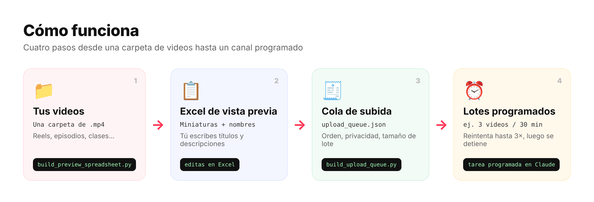
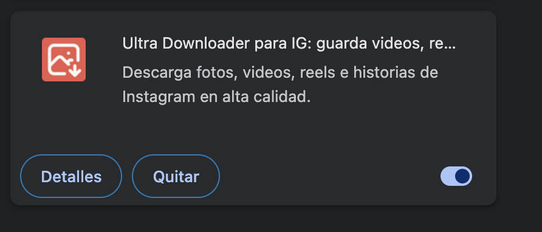
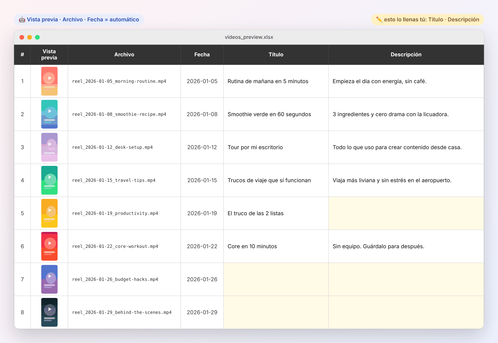
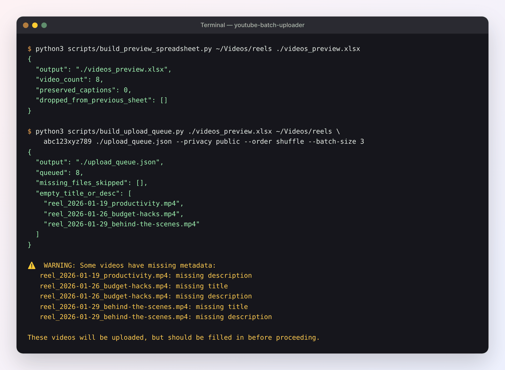
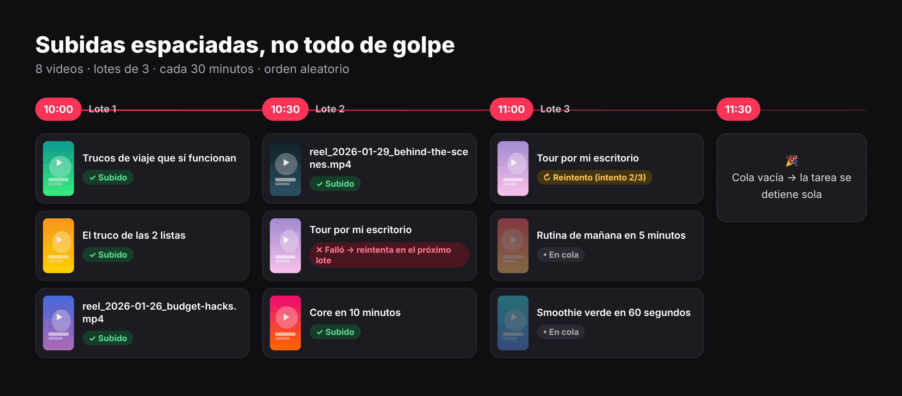

<p align="center">
  <a href="README.md">🇬🇧 English</a> · <b>🇪🇸 Español</b>
</p>

<p align="center">
  
</p>

<p align="center">
  <a href="https://www.python.org/downloads/"></a>
  <a href="LICENSE"></a>
  
  
</p>

<p align="center">
  <b>Deja de subir videos uno por uno.</b><br>
  Dale una segunda vida en YouTube a los Reels y videos que ya publicaste en Instagram.<br>
  Descárgalos, revísalos en un Excel visual y deja que Claude los suba en lotes espaciados — con orden aleatorio y reintentos automáticos.
</p>

---

## ✨ ¿Qué hace?

| Característica | Por qué importa |
|---|---|
| 📲 **Reutiliza tu contenido de Instagram** | Convierte los Reels que ya publicaste en videos de YouTube, sin grabar nada nuevo |
| 📋 **Excel con miniaturas** | Ves cada video antes de publicarlo y escribes títulos/descripciones en un solo lugar |
| ⏰ **Lotes espaciados** | Por ejemplo, 3 videos cada 30 minutos, en vez de 100 de golpe |
| 🔀 **Orden secuencial o aleatorio** | El aleatorio evita que tu canal parezca un "batch dump" |
| 🛡️ **Reintentos automáticos** | Las subidas fallidas se reintentan hasta 3 veces |
| ♻️ **Re-ejecuciones seguras** | Al regenerar el Excel se conservan los títulos que ya escribiste |
| 📊 **Seguimiento del progreso** | El estado de cada video queda en `upload_queue.json` |

## 🎯 Ideal para

📲 **Creadores de Instagram que quieren reutilizar sus Reels** · 🎙️ **Podcasters** · 🎬 **Creadores de Reels / TikTok** · 🎓 **Creadores de cursos** · 📺 **Streamers** · 📸 **Bancos de stock footage**

Guías paso a paso (en inglés): [Podcasters](examples/PODCASTERS.md) · [Creadores de Reels](examples/REELS_CREATORS.md) · [Creadores de cursos](examples/COURSE_CREATORS.md)

---

## 🧭 Cómo funciona

<p align="center">
  
</p>

---

## 🚀 Inicio rápido (5 minutos)

### Requisitos

- Python 3.8+
- macOS (las miniaturas se generan con Quick Look)
- Un canal de YouTube
- Claude con el **MCP de YouTube Studio** conectado

### 0️⃣ Descarga tus videos de Instagram *(sáltalo si ya tienes los archivos)*

La idea de esta herramienta es reutilizar lo que **ya publicaste**. Si tus videos solo están en Instagram, descárgalos primero:

1. En **Chrome**, instala la extensión **[Ultra Downloader para IG](https://chromewebstore.google.com/detail/ultra-downloader-para-ig/daokalfcfkhheoiimjbmfclcogpgahkm)**.

   > 💡 No tiene que ser necesariamente esta: sirve cualquier extensión de Chrome que descargue videos/Reels de Instagram en lote. Lo importante es que termines con archivos `.mp4`.

   

2. Abre [instagram.com](https://www.instagram.com) en Chrome, inicia sesión y entra a tu perfil.
3. Usa el botón de la extensión en Instagram y elige la descarga masiva **solo de videos / Reels** (sin fotos). Algunas extensiones lo entregan todo en un `.zip`.
4. Si te llegó un `.zip`, descomprímelo. Mueve **solo los archivos `.mp4`** a **una sola carpeta**, por ejemplo `~/Videos/reels`. Esa carpeta es la que usarás en todos los pasos siguientes.

> ⚠️ Descarga solo contenido tuyo o que tengas derecho a republicar. La extensión es de terceros y no tiene relación con Instagram ni con este proyecto.

### 1️⃣ Instalar

```bash
git clone https://github.com/alexadarks/youtube-batch-uploader.git
cd youtube-batch-uploader
pip install -r requirements.txt
```

### 2️⃣ Conectar YouTube con Claude

**Opción A — YouTubeStudioMCP.com (recomendada)**
1. Entra a [YouTubeStudioMCP.com](https://YouTubeStudioMCP.com) e inicia sesión con Google
2. Autoriza el acceso a tu canal
3. Copia tu **ID de Conexión** (Connection ID)

**Opción B — Configuración de Claude**
1. En Claude, abre Configuración → Conectores y busca "YouTube Studio"
2. Conéctalo e inicia sesión con Google
3. Anota el nombre de tu canal o tu ID de Conexión

### 3️⃣ Configurar

```bash
cp config.example.yaml config.yaml
# Agrega tu ID de Conexión, la carpeta de videos y tus preferencias
```

### 4️⃣ Generar el Excel de vista previa

```bash
python3 scripts/build_preview_spreadsheet.py "/ruta/a/videos" "./videos_preview.xlsx"
```

Obtienes un Excel con una miniatura por video. Completa **Título** y **Descripción**:

<p align="center">
  
</p>

> 💡 Las fechas se extraen solas de nombres como `reel_2026-01-15_travel-tips.mp4`. Las celdas resaltadas siguen vacías: el siguiente paso te avisa de ellas.

### 5️⃣ Crear la cola de subida

```bash
python3 scripts/build_upload_queue.py \
  "./videos_preview.xlsx" "/ruta/a/videos" "TU_ID_DE_CONEXION" "./upload_queue.json" \
  --privacy public --order shuffle --batch-size 3
```

Ambos scripts muestran un resumen en JSON y te avisan si falta algo antes de subir un solo video:

<p align="center">
  
</p>

### 6️⃣ Programar las subidas

Pídele a Claude:

> *"Configura una tarea programada que suba el siguiente lote de `/ruta/a/upload_queue.json` cada 30 minutos."*

Cada ejecución sube el siguiente lote, actualiza la cola y la tarea se detiene sola cuando termina:

<p align="center">
  
</p>

✅ **¡Listo!** Tus videos se publican solos.

---

## ⚙️ Opciones

| Flag (`build_upload_queue.py`) | Valores | Por defecto |
|---|---|---|
| `--privacy` | `public` · `unlisted` · `private` | `public` |
| `--order` | `sequential` · `shuffle` | `shuffle` |
| `--batch-size` | videos por ejecución | `3` |
| `--seed` | cualquier número, para repetir el mismo orden aleatorio | — |

El **intervalo** entre lotes se define en la tarea programada (por ejemplo, cada 30 minutos).

**Ritmo sugerido**

| Canal | Tamaño de lote | Intervalo |
|---|---|---|
| 🌱 Nuevo / pequeño | 1 | 60 min |
| 🌿 En crecimiento | 3 | 30 min |
| 🌳 Consolidado | 5 | 15 min |

<details>
<summary><b>📄 Ejemplo completo de <code>config.yaml</code></b></summary>

```yaml
youtube:
  connection_id: "TU_ID_DE_CONEXION"   # de YouTubeStudioMCP.com
  channel_name: "Mi Canal"             # se valida antes de subir
  privacy_status: "public"             # public, unlisted, private

upload:
  batch_size: 3
  interval_minutes: 30
  order: "shuffle"                     # sequential o shuffle
  seed: null

paths:
  video_directory: "/ruta/a/videos"
  preview_spreadsheet: "./videos_preview.xlsx"
  upload_queue: "./upload_queue.json"
  thumbnail_cache: "./.preview_thumbs_cache"
```

</details>

<details>
<summary><b>📊 Columnas del Excel</b></summary>

El archivo generado usa los encabezados en inglés:

| Columna | Contenido | Editable |
|---|---|---|
| # | Número de fila | No |
| Preview | Miniatura | No |
| Filename | Nombre del archivo | No |
| Date | Fecha del nombre de archivo (`AAAA-MM-DD`) | No |
| Title | Título del video | **Sí** |
| Description | Descripción del video | **Sí** |

</details>

---

## 🚨 Problemas comunes

<details>
<summary><b>⚠️ El .xlsx se convirtió en .numbers</b></summary>

Abrirlo con Numbers en macOS puede convertirlo. Expórtalo de vuelta (Archivo → Exportar a → Excel) o regenéralo con `build_preview_spreadsheet.py`: tus títulos se conservan.
</details>

<details>
<summary><b>⚠️ Borré filas y las miniaturas se desordenaron</b></summary>

No borres filas a mano. Quita el `.mp4` de la carpeta y vuelve a correr `build_preview_spreadsheet.py`: reconstruye el Excel, mantiene tus títulos y elimina los archivos que ya no existen.
</details>

<details>
<summary><b>⚠️ No aparecen miniaturas</b></summary>

- Las miniaturas requieren macOS (`qlmanage`)
- Revisa que el video sea válido: `file video.mp4`
- Limpia la caché y reintenta: `rm -rf /ruta/a/videos/.preview_thumbs_cache/`
</details>

<details>
<summary><b>⚠️ "Connection ID not found"</b></summary>

Verifica el ID en YouTubeStudioMCP.com y pídele a Claude: *"Lista mis canales de YouTube"* para probar la conexión.
</details>

<details>
<summary><b>⚠️ Los videos no se suben</b></summary>

- Busca el campo `error` en `upload_queue.json`
- Confirma que el MCP de YouTube Studio sigue conectado en Claude
- Revisa la cuota diaria de subidas de tu canal
- ¿Archivos pesados? Baja el tamaño de lote y aumenta el intervalo
</details>

Más ayuda: [SETUP.md](SETUP.md) · [examples/WORKFLOW.md](examples/WORKFLOW.md)

---

## 📚 Documentación

| Documento | Tiempo | Para |
|---|---|---|
| [QUICKSTART.md](QUICKSTART.md) | 5 min | Si estás apurada/o |
| [SETUP.md](SETUP.md) | 15 min | Primera configuración |
| [examples/WORKFLOW.md](examples/WORKFLOW.md) | 25 min | Guía completa + solución de problemas |
| [INDEX.md](INDEX.md) | — | Todos los documentos del repo |

## 🤝 Contribuir

Ideas y reportes de bugs son bienvenidos — revisa [CONTRIBUTING.md](CONTRIBUTING.md) y [PROJECT_STRUCTURE.md](PROJECT_STRUCTURE.md).
**En el roadmap:** miniaturas en Linux/Windows, interfaz web y más plataformas.

## 📄 Licencia

**MIT** — úsalo libremente, de forma personal o comercial. Ver [LICENSE](LICENSE).

---

<p align="center">
  Hecho con ❤️ para creadores de contenido por <a href="https://github.com/alexadarks">@alexadarks</a><br>
  <i>Porque subir 100 videos a mano no es un rasgo de personalidad.</i>
</p>
