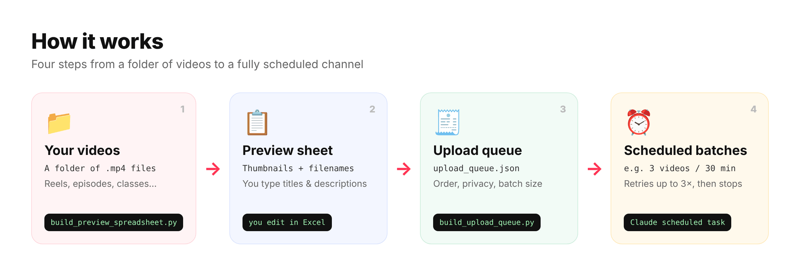
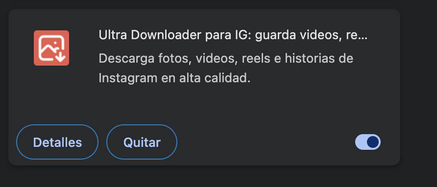
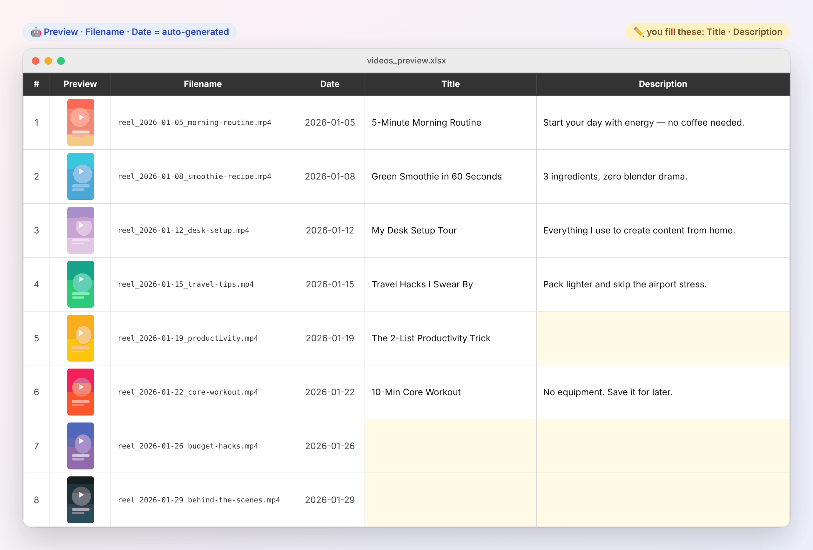
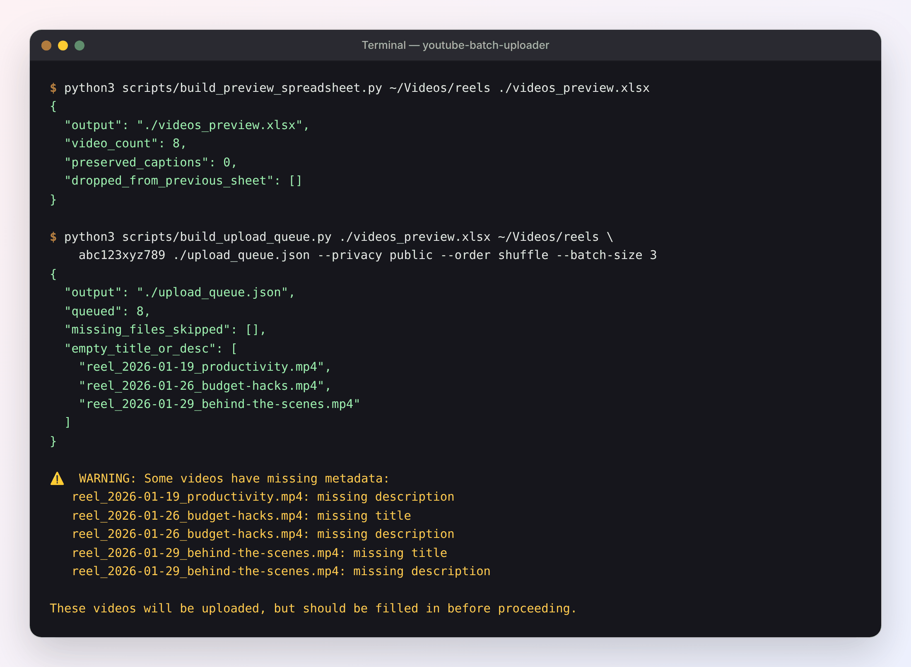
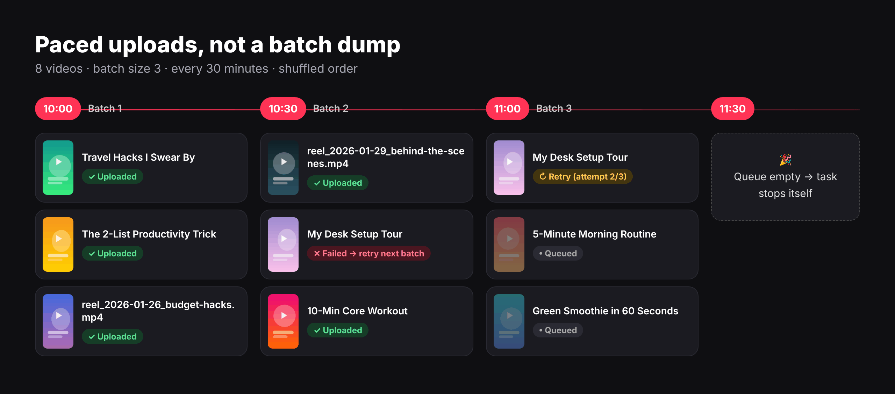

<p align="center">
  <b>🇬🇧 English</b> · <a href="README.es.md">🇪🇸 Español</a>
</p>

<p align="center">
  
</p>

<p align="center">
  <a href="https://www.python.org/downloads/"></a>
  <a href="LICENSE"></a>
  
  
</p>

<p align="center">
  <b>Stop uploading videos one by one.</b><br>
  Give the Reels and videos you already published on Instagram a second life on YouTube.<br>
  Download them, review them in a visual Excel sheet, and let Claude upload them in paced batches — with shuffle order and automatic retries.
</p>

---

## ✨ What it does

| Feature | Why it matters |
|---|---|
| 📲 **Reuse your Instagram content** | Turn the Reels you already published into YouTube videos — no new filming needed |
| 📋 **Excel preview with thumbnails** | See every video before it goes live and type titles/descriptions in one place |
| ⏰ **Paced batches** | e.g. 3 videos every 30 minutes, instead of 100 at once |
| 🔀 **Sequential or shuffled order** | Shuffle so your channel doesn't look like a "batch dump" |
| 🛡️ **Automatic retries** | Failed uploads are retried up to 3 times |
| ♻️ **Safe re-runs** | Rebuilding the sheet keeps the titles you already typed |
| 📊 **Progress tracking** | Every video's status lives in `upload_queue.json` |

## 🎯 Perfect for

📲 **Instagram creators repurposing their Reels** · 🎙️ **Podcasters** · 🎬 **Reels / TikTok creators** · 🎓 **Course creators** · 📺 **Streamers** · 📸 **Stock footage libraries**

Step-by-step guides: [Podcasters](examples/PODCASTERS.md) · [Reels creators](examples/REELS_CREATORS.md) · [Course creators](examples/COURSE_CREATORS.md)

---

## 🧭 How it works

<p align="center">
  
</p>

---

## 🚀 Quick start (5 minutes)

### Prerequisites

- Python 3.8+
- macOS (thumbnails are generated with Quick Look)
- A YouTube channel
- Claude with the **YouTube Studio MCP** connected

### 0️⃣ Download your Instagram videos *(skip if you already have the files)*

The point of this tool is to reuse what you've **already published**. If your videos only live on Instagram, download them first:

1. In **Chrome**, install the **[Ultra Downloader para IG](https://chromewebstore.google.com/detail/ultra-downloader-para-ig/daokalfcfkhheoiimjbmfclcogpgahkm)** extension.

   > 💡 It doesn't have to be this one — any Chrome extension that bulk-downloads Instagram videos/Reels works. Just make sure you end up with `.mp4` files.

   

2. Open [instagram.com](https://www.instagram.com) in Chrome, log in, and go to your profile.
3. Use the extension's button on Instagram and choose the bulk download option for **videos / Reels only** (no photos). Some extensions deliver everything in a `.zip`.
4. If you got a `.zip`, unzip it. Move **only the `.mp4` files** into **one single folder**, e.g. `~/Videos/reels`. That folder is what you'll use in every step below.

> ⚠️ Only download content you own or have the rights to republish. The extension is a third-party tool, not affiliated with Instagram or this project.

### 1️⃣ Install

```bash
git clone https://github.com/alexadarks/youtube-batch-uploader.git
cd youtube-batch-uploader
pip install -r requirements.txt
```

### 2️⃣ Connect YouTube to Claude

**Option A — YouTubeStudioMCP.com (recommended)**
1. Go to [YouTubeStudioMCP.com](https://YouTubeStudioMCP.com) and sign in with Google
2. Authorize access to your channel
3. Copy your **Connection ID**

**Option B — Claude settings**
1. In Claude, open Settings → Connectors and search for "YouTube Studio"
2. Connect it and sign in with Google
3. Note your channel name or Connection ID

### 3️⃣ Configure

```bash
cp config.example.yaml config.yaml
# Add your Connection ID, video folder and preferences
```

### 4️⃣ Generate the preview spreadsheet

```bash
python3 scripts/build_preview_spreadsheet.py "/path/to/videos" "./videos_preview.xlsx"
```

You get an Excel file with a thumbnail for every video. Fill in **Title** and **Description**:

<p align="center">
  
</p>

> 💡 Dates are pulled automatically from filenames like `reel_2026-01-15_travel-tips.mp4`. Highlighted cells are still empty — the next step will warn you about them.

### 5️⃣ Build the upload queue

```bash
python3 scripts/build_upload_queue.py \
  "./videos_preview.xlsx" "/path/to/videos" "YOUR_CONNECTION_ID" "./upload_queue.json" \
  --privacy public --order shuffle --batch-size 3
```

Both scripts print a JSON summary and flag anything missing before a single video is uploaded:

<p align="center">
  
</p>

### 6️⃣ Schedule the uploads

Ask Claude:

> *"Set up a scheduled task that uploads the next batch from `/path/to/upload_queue.json` every 30 minutes."*

Each run uploads the next batch, updates the queue, and the task stops itself when everything is done:

<p align="center">
  
</p>

✅ **Done!** Your videos go live on their own.

---

## ⚙️ Options

| Flag (`build_upload_queue.py`) | Values | Default |
|---|---|---|
| `--privacy` | `public` · `unlisted` · `private` | `public` |
| `--order` | `sequential` · `shuffle` | `shuffle` |
| `--batch-size` | videos per run | `3` |
| `--seed` | any number, for a reproducible shuffle | — |

The **interval** between batches is set in the scheduled task itself (e.g. every 30 minutes).

**Suggested pacing**

| Channel | Batch size | Interval |
|---|---|---|
| 🌱 New / small | 1 | 60 min |
| 🌿 Growing | 3 | 30 min |
| 🌳 Established | 5 | 15 min |

<details>
<summary><b>📄 Full <code>config.yaml</code> example</b></summary>

```yaml
youtube:
  connection_id: "YOUR_CONNECTION_ID"   # from YouTubeStudioMCP.com
  channel_name: "My Channel"            # checked before uploading
  privacy_status: "public"              # public, unlisted, private

upload:
  batch_size: 3
  interval_minutes: 30
  order: "shuffle"                      # sequential or shuffle
  seed: null

paths:
  video_directory: "/path/to/videos"
  preview_spreadsheet: "./videos_preview.xlsx"
  upload_queue: "./upload_queue.json"
  thumbnail_cache: "./.preview_thumbs_cache"
```

</details>

<details>
<summary><b>📊 Spreadsheet columns</b></summary>

| Column | Content | Editable |
|---|---|---|
| # | Row number | No |
| Preview | Thumbnail | No |
| Filename | Video filename | No |
| Date | From the filename (`YYYY-MM-DD`) | No |
| Title | Video title | **Yes** |
| Description | Video description | **Yes** |

</details>

---

## 🚨 Common issues

<details>
<summary><b>⚠️ The .xlsx turned into a .numbers file</b></summary>

Opening the sheet in Numbers on macOS can convert it. Export it back (File → Export To → Excel) or just rebuild it with `build_preview_spreadsheet.py` — your typed titles are kept.
</details>

<details>
<summary><b>⚠️ I deleted rows and thumbnails got mixed up</b></summary>

Don't delete rows by hand. Remove the `.mp4` from the folder and re-run `build_preview_spreadsheet.py`: it rebuilds the sheet, keeps your titles and drops missing files.
</details>

<details>
<summary><b>⚠️ No thumbnails</b></summary>

- Thumbnails need macOS (`qlmanage`)
- Check the video is valid: `file video.mp4`
- Clear the cache and retry: `rm -rf /path/to/videos/.preview_thumbs_cache/`
</details>

<details>
<summary><b>⚠️ "Connection ID not found"</b></summary>

Double-check the ID on YouTubeStudioMCP.com, then ask Claude: *"List my YouTube channels"* to test the connection.
</details>

<details>
<summary><b>⚠️ Videos aren't uploading</b></summary>

- Look for the `error` field in `upload_queue.json`
- Make sure the YouTube Studio MCP is still connected in Claude
- Check your channel's daily upload quota
- Large files? Lower the batch size and increase the interval
</details>

More help: [SETUP.md](SETUP.md) · [examples/WORKFLOW.md](examples/WORKFLOW.md)

---

## 📚 Documentation

| Doc | Time | For |
|---|---|---|
| [QUICKSTART.md](QUICKSTART.md) | 5 min | You're in a hurry |
| [SETUP.md](SETUP.md) | 15 min | First-time setup |
| [examples/WORKFLOW.md](examples/WORKFLOW.md) | 25 min | Full walkthrough + troubleshooting |
| [INDEX.md](INDEX.md) | — | Every doc in the repo |

## 🤝 Contributing

Ideas and bug reports are welcome — see [CONTRIBUTING.md](CONTRIBUTING.md) and [PROJECT_STRUCTURE.md](PROJECT_STRUCTURE.md).
**On the roadmap:** Linux/Windows thumbnails, a web UI, more platforms.

## 📄 License

**MIT** — free for personal and commercial use. See [LICENSE](LICENSE).

---

<p align="center">
  Made with ❤️ for content creators by <a href="https://github.com/alexadarks">@alexadarks</a><br>
  <i>Because uploading 100 videos by hand is not a personality trait.</i>
</p>
